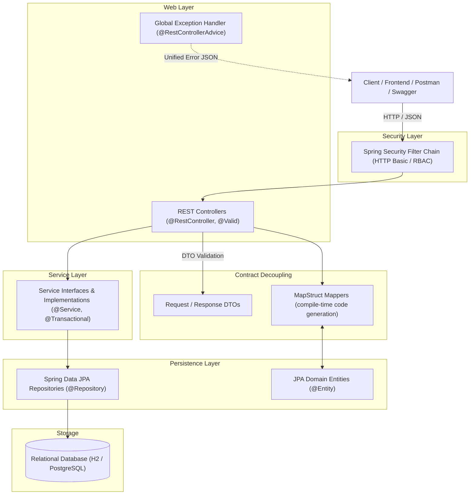
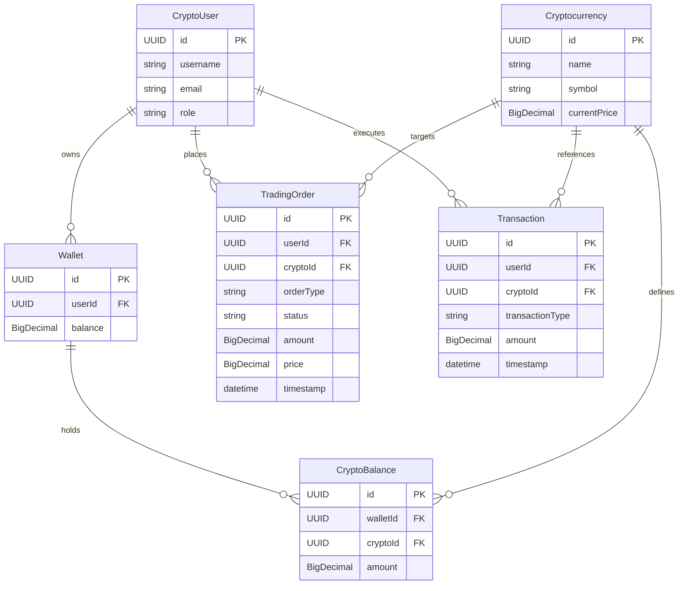

# 🚀 Crypto Trading & Wallet Platform · Enterprise REST API Backend

[](https://www.oracle.com/java/)
[](https://spring.io/projects/spring-boot)
[](https://spring.io/projects/spring-security)
[](https://spring.io/projects/spring-data-jpa)
[](https://mapstruct.org/)
[](https://swagger.io/)
[](LICENSE)

An enterprise-grade, multi-tier REST API backend developed in **Java 17** and **Spring Boot 3** for cryptocurrency portfolio management, real-time balance tracking, and automated trading order lifecycles.

Built with a strong emphasis on **clean architecture**, **SOLID design principles** (notably Single Responsibility Principle), **DTO decoupling via MapStruct**, and **Role-Based Access Control (RBAC)** with Spring Security.

---

## 🏛️ Architecture Overview

The system strictly adheres to the **Layered (3-Tier) Architecture** to ensure clean separation of concerns, high testability, and seamless maintainability:



---

## ✨ Key Features & Engineering Highlights

### 1. Separation of Concerns & Single Responsibility Principle (SRP)
* **Controllers** handle HTTP routing, request decoding, header negotiation, and Jakarta validation (`@Valid`).
* **Services** encapsulate pure domain business rules (order placement, funds sufficiency validation, atomic wallet adjustments).
* **Repositories** leverage Spring Data JPA to provide abstracted data access with custom query derivations.
* **DTOs & MapStruct** insulate database entities from API client contracts, preventing over-fetching and protecting internal persistence structures.

### 2. Trading Order Lifecycle & Financial Auditing
* **Trading Orders:** Supports `BUY` and `SELL` limit orders with dynamic lifecycle states (`CREATED`, `EXECUTED`, `CANCELLED`).
* **Wallet Management:** Multi-currency balance accounting linking fiat balances to individual cryptocurrency positions.
* **Transaction Ledger:** Immutable historical records tracking all balance debits and credits across users.

### 3. Enterprise Security & Method-Level RBAC
* Configured with **Spring Security 6** with method-level authorization (`@EnableMethodSecurity`, `@PreAuthorize("hasRole('USER')")`).
* Password hashing using **BCrypt** with 10 salt rounds.
* In-memory test accounts pre-configured for instant evaluation.

### 4. Robust Centralized Exception Handling
* Centralized `@RestControllerAdvice` translates domain exceptions (`NotFoundException`, `IllegalArgumentException`, `MethodArgumentNotValidException`) into uniform RFC-compliant JSON error bodies (`ExceptionBody`).

---

## 🗄️ Domain Model



---

## 📡 REST API Reference

All endpoints are organized under the `/api/v1` namespace and documentable via Swagger UI:

| HTTP Method | Endpoint | Description | Required Role |
|:---|:---|:---|:---|
| **POST** | `/api/v1/trading-orders` | Create a new trading order | `USER` |
| **GET** | `/api/v1/trading-orders/{id}` | Get trading order by ID | `USER` |
| **GET** | `/api/v1/trading-orders` | List all trading orders | `USER` |
| **PUT** | `/api/v1/trading-orders/{id}` | Update existing order | `USER` |
| **DELETE** | `/api/v1/trading-orders/{id}` | Cancel / delete order | `USER` |
| **POST** | `/api/v1/wallets` | Initialize a new wallet | `USER` |
| **GET** | `/api/v1/wallets/{id}` | Retrieve wallet by ID | `USER` |
| **GET** | `/api/v1/wallets` | List all wallets | `ADMIN` |
| **PUT** | `/api/v1/wallets/{id}` | Update wallet details | `USER` |
| **DELETE** | `/api/v1/wallets/{id}` | Delete wallet | `ADMIN` |
| **POST** | `/api/v1/crypto-balances` | Add balance to wallet | `USER` |
| **GET** | `/api/v1/crypto-balances/{id}` | Get balance by ID | `USER` |
| **PUT** | `/api/v1/crypto-balances/{id}/adjust` | Adjust coin holdings | `USER` |
| **POST** | `/api/v1/cryptocurrencies` | Register new cryptocurrency | `ADMIN` |
| **GET** | `/api/v1/cryptocurrencies` | List all available assets | Public / `USER` |
| **GET** | `/api/v1/cryptocurrencies/{id}` | Get cryptocurrency details | Public / `USER` |
| **POST** | `/api/v1/users` | Register a new user | Public |
| **GET** | `/api/v1/users` | List users (paginated) | `ADMIN` |
| **GET** | `/api/v1/users/{id}` | Get user profile by ID | `USER` |
| **POST** | `/api/v1/transactions` | Record a ledger transaction | `USER` |
| **GET** | `/api/v1/transactions/{id}` | Get transaction details | `USER` |

---

## 🛠️ Tech Stack & Dependencies

* **Language:** Java 17 (LTS)
* **Framework:** Spring Boot 3.2.4
* **Security:** Spring Security 6.2 (RBAC, Method Security, BCrypt)
* **Persistence:** Spring Data JPA, Hibernate ORM
* **Mapping:** MapStruct 1.5.5.Final
* **Database:** H2 Database (in-memory, zero-config setup for development)
* **Documentation:** SpringDoc OpenAPI 3 (Swagger UI 2.3.0)
* **Boilerplate Reduction:** Project Lombok 1.18.30
* **Build Tool:** Apache Maven 3.9+

---

## 🚀 Getting Started

### Prerequisites
* **Java Development Kit (JDK) 17** or higher installed.
* **Apache Maven 3.8+** (or use your IDE's bundled Maven: IntelliJ IDEA / Eclipse / VS Code).

### Installation & Run

1. **Clone the repository:**
   ```bash
   git clone https://github.com/GhileaLucian/crypto-trading-backend.git
   cd crypto-trading-backend
   ```

2. **Build and package:**
   ```bash
   mvn clean install
   ```

3. **Run the Spring Boot application:**
   ```bash
   mvn spring-boot:run
   ```

4. **Access the interactive documentation:**
   * **Swagger UI:** [http://localhost:8080/swagger-ui.html](http://localhost:8080/swagger-ui.html)
   * **OpenAPI Specs (JSON):** [http://localhost:8080/v3/api-docs](http://localhost:8080/v3/api-docs)
   * **H2 Database Console:** [http://localhost:8080/h2-console](http://localhost:8080/h2-console)  
     *(JDBC URL: `jdbc:h2:mem:cryptodb`, Username: `sa`, Password: empty)*

### Pre-configured Test Accounts (HTTP Basic Auth)
* **Trader:** `username: trader` / `password: trader123` (Roles: `USER`)
* **Administrator:** `username: admin` / `password: admin123` (Roles: `ADMIN`, `USER`)

---

## 👤 Author

**Dan Lucian Ghilea**  
*MSc Student in Applied Informatics in Complex Systems · Technical University of Cluj-Napoca (TUCN)*  
* **LinkedIn:** [linkedin.com/in/lucian-ghilea](https://linkedin.com/in/lucian-ghilea)  
* **Email:** [danlucianghilea@gmail.com](mailto:danlucianghilea@gmail.com)  
* **GitHub:** [@GhileaLucian](https://github.com/GhileaLucian)

---

## 📄 License

This project is licensed under the [MIT License](LICENSE).
